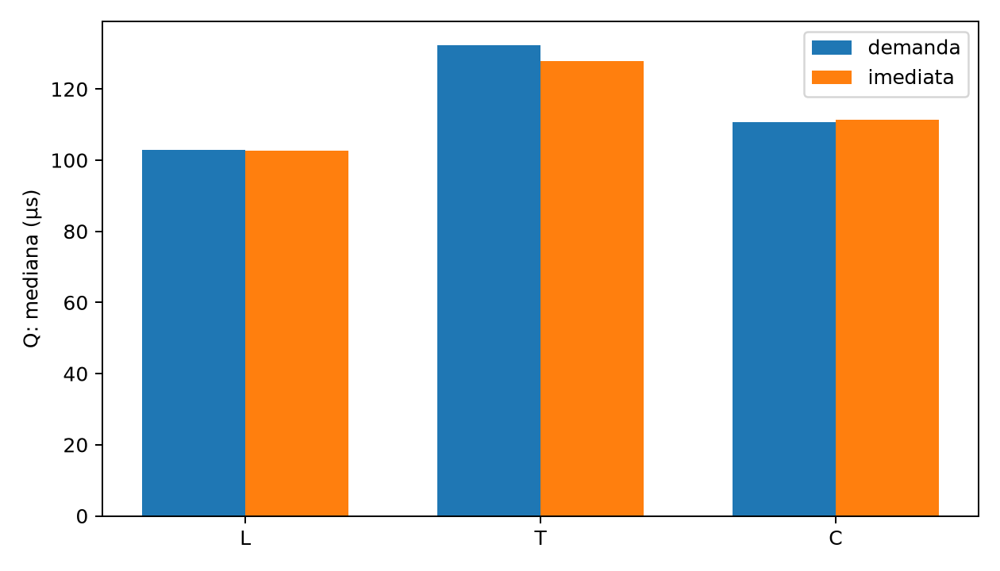

# Forja de Blibblon ⚒️

**Sistema de gerenciamento de equipamentos e recomendação de itens com matrizes esparsas em C++11.**

> **Projeto acadêmico — Universidade Federal de Minas Gerais (UFMG)**  
> Desenvolvido como **Trabalho Prático de Estruturas de Dados** no curso de **Ciência da Computação** (2026).

## Visão geral

A Forja de Blibblon simula uma oficina de itens de fantasia. Cada item modifica apenas uma pequena parte dos atributos disponíveis: uma aplicação natural de **matrizes esparsas**. O sistema mantém um catálogo de modificadores, administra encomendas em uma **fila FIFO**, equipa itens em **pilhas LIFO** por personagem e recomenda novos equipamentos com métricas ponderadas.

O objetivo principal do trabalho é comparar **decisões de implementação**, e não somente obter saídas corretas: o catálogo pode mudar de representação durante a execução sem perder os modificadores existentes.

### Destaques técnicos

- **Três representações de matriz esparsa**, com migração durante a execução:
  - `L`: lista cruzada, com acesso por linha e por coluna;
  - `T`: vetor de tripletas ordenadas;
  - `C`: armazenamento comprimido por linha (**CSR**).
- **TADs próprios em C++11** para catálogo, atributos, itens, aventureiros, fila, pilha e texto dinâmico.
- **Recomendação** combinando poder, equilíbrio e sinergia, com pesos configuráveis.
- **Consulta por intervalo** (`LF`), usando índice auxiliar e tratando zeros implícitos (inclusive células ausentes/removidas).
- **Análise experimental** com comparação de perfis de atualizações e consultas, contadores de operações, custos de memória, algoritmos de ordenação e produto interno.
- **Validações automatizadas** de TADs e comandos, além de documentação técnica.

## Arquitetura

```text
forja-de-blibblon/
├── include/                # Interfaces dos tipos abstratos de dados
├── src/                    # Implementações e ponto de entrada CLI
├── examples/               # Exemplo de entrada e saída verificadas
├── experiments/            # Bancadas em C++ e automação em Python
│   └── results/            # Medições CSV e gráfico do relatório
├── docs/
│   └── relatorio-tecnico.pdf
├── Makefile
├── .gitignore
└── README.md
```

A interface do `Catalogo` permite que a camada de comandos realize consultas e atualizações sem precisar saber qual estrutura (`L`, `T` ou `C`) está em uso. O sistema utiliza **alocação dinâmica manual e TADs próprios**, em conformidade com as restrições didáticas do trabalho; isso é uma escolha de escopo acadêmico, não uma recomendação geral para softwares de produção.

## Como executar

**Pré-requisitos:** compilador `g++` com suporte a C++11 e `make` (no Windows com MinGW, `mingw32-make`). Não são necessárias bibliotecas externas para o programa principal.

No terminal, a partir da raiz do projeto:

```bash
make
./bin/tp1.out < examples/exemplo_entrada.txt
```

No Windows (PowerShell, com MinGW):

```powershell
mingw32-make
Get-Content examples/exemplo_entrada.txt | .\bin\tp1.out
```

O arquivo [`examples/exemplo_saida.txt`](examples/exemplo_saida.txt) contém a saída produzida pelo programa para o exemplo. Para informar novos comandos, execute `./bin/tp1.out` e digite a entrada ou redirecione um arquivo de texto.

## Operações disponíveis

| Comando | Função |
|:--|:--|
| `E L`, `E T`, `E C` | Seleciona ou migra a representação do catálogo |
| `A nome` / `I nome` / `H nome` | Cadastra atributo, item ou aventureiro |
| `M i j v` | Define o modificador do item `i` no atributo `j` (zero remove a célula) |
| `F h i` / `Z k` / `D h` | Enfileira pedido, fabrica até `k` itens ou desequipa o último item |
| `LI i` / `LA j` / `LH h` | Consulta modificadores de um item, de um atributo ou da build |
| `LF j minimo maximo` | Lista itens cujos valores no atributo estão no intervalo, incluindo zeros implícitos |
| `Q h n m` | Recomenda até `n` itens com `m` métricas lidas nas linhas seguintes |

Após `Q h n m`, informe uma linha `NOME_METRICA peso` para cada uma das `m` métricas; nomes aceitos: `PODER`, `EQUILIBRIO` e `SINERGIA`.

### Fluxo de exemplo

```text
F 0 0      # Pedido do aventureiro 0 para o item 0
F 0 1      # Novo pedido
Z 2        # Fabrica ate 2 pedidos na ordem FIFO
LH 0       # Consulta os atributos acumulados
D 0        # Remove o ultimo equipamento (LIFO)
```

*Os comentários acima explicam o fluxo; utilize o arquivo de exemplo para a sintaxe de entrada aceita pelo programa.*

## Resultados experimentais

O relatório compara as estruturas com **256 itens**, **128 atributos**, cerca de **5% de densidade inicial**, **1.200 comandos por perfil** e cinco repetições. Na configuração-base do perfil voltado a consultas, com **build sob demanda**, a mediana das médias por operação foi:

| Representação | Recomendação `Q` (µs) |
|:--|--:|
| Lista cruzada (`L`) | **103,0** |
| Tripletas (`T`) | 132,4 |
| Comprimida (`C`) | 110,7 |

Na mesma base, a estimativa de memória total do catálogo foi de **74.948 bytes (L)**, **64.568 bytes (T)** e **57.404 bytes (C)**, correspondendo a **aproximadamente 23,4% menos em C que em L**.



> **Como interpretar:** os números descrevem **as cargas e o ambiente dos experimentos**, não uma promessa universal de velocidade. As medições isolam as operações da bancada (sem o custo de entrada/saída textual) e usam estimativas de memória calculadas sobre objetos e capacidades, não o pico de memória de todo o processo. A lista cruzada favoreceu as consultas dessas cargas; o modo comprimido teve menor estimativa de memória. Consulte [o relatório](docs/relatorio-tecnico.pdf) para metodologia, limitações e outras comparações.

Os arquivos CSV em [`experiments/results/`](experiments/results/) permitem inspecionar as medições. Veja [como repetir a análise](experiments/README.md).

## Testes e validação

Além do arquivo de exemplo, a bancada inclui verificações de TADs, migrações entre modos e comparação das saídas do programa. Para recompilar os verificadores e executá-los:

```bash
python experiments/preparar.py
```

Essa etapa exige **Python 3** e `g++`. Os testes são automáticos, mas não substituem uma suíte de integração para todas as entradas possíveis.

## Aprendizados

O principal aprendizado foi perceber que a escolha de uma estrutura depende do **perfil de operações e do padrão real de acesso à memória**. Busca binária pode localizar uma posição rapidamente sem tornar barata uma inserção que desloca vetores; e manter índices auxiliares pode acelerar consultas à custa de atualizações mais caras.

Como próximos passos, o relatório sugere otimizações ainda **não implementadas**, como redução de recomputações da norma durante `Q` e exploração de estratégias híbridas de ordenação.

## Contexto acadêmico e documentação

Este repositório apresenta uma versão organizada para portfólio de um **trabalho prático universitário da disciplina de Estruturas de Dados na UFMG**. O tema e os requisitos foram definidos no contexto da disciplina; a implementação e a análise experimental constituem o trabalho desenvolvido para essa atividade. O relatório preserva a declaração de uso de ferramentas de IA na revisão de código, experimentos e redação. O número de matrícula foi omitido da cópia pública.

**Documentação completa:** [`docs/relatorio-tecnico.pdf`](docs/relatorio-tecnico.pdf).

**Observação:** o conteúdo é disponibilizado para demonstração acadêmica e técnica. Este repositório não inclui licença de reutilização de código; a política de publicação da disciplina deve ser conferida antes de torná-lo público.
